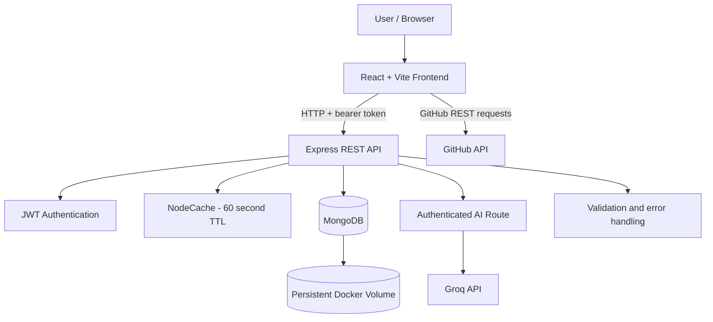
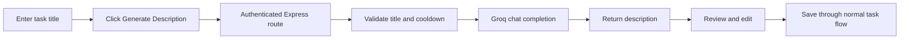
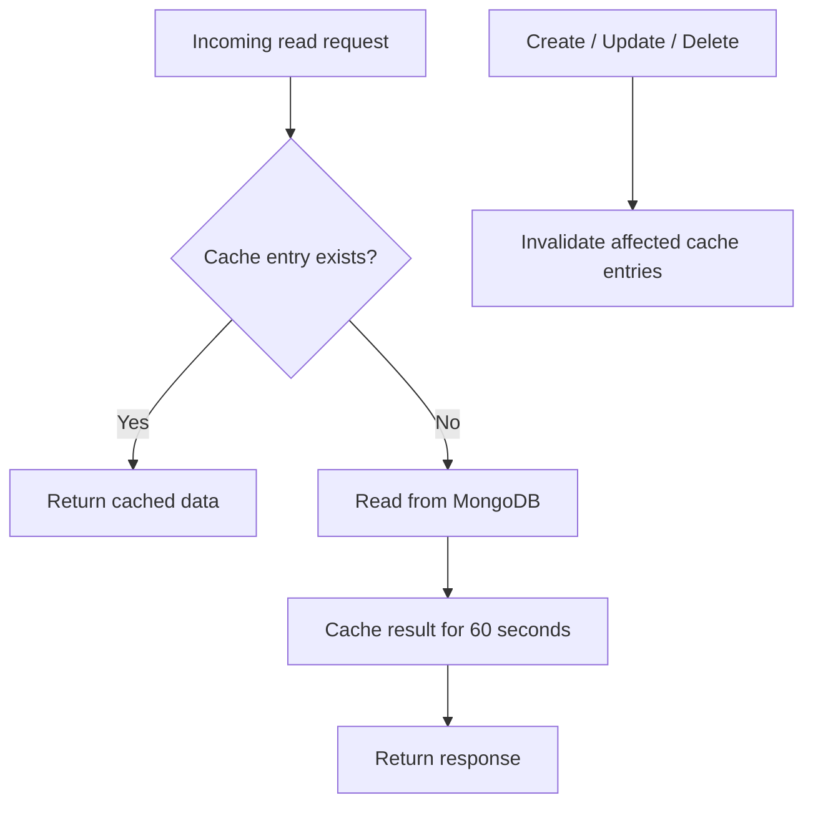
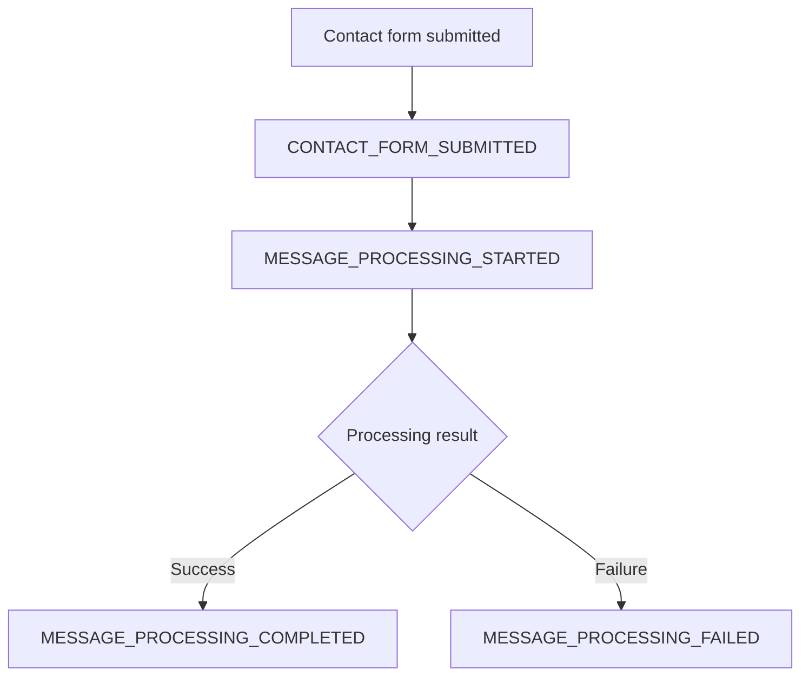
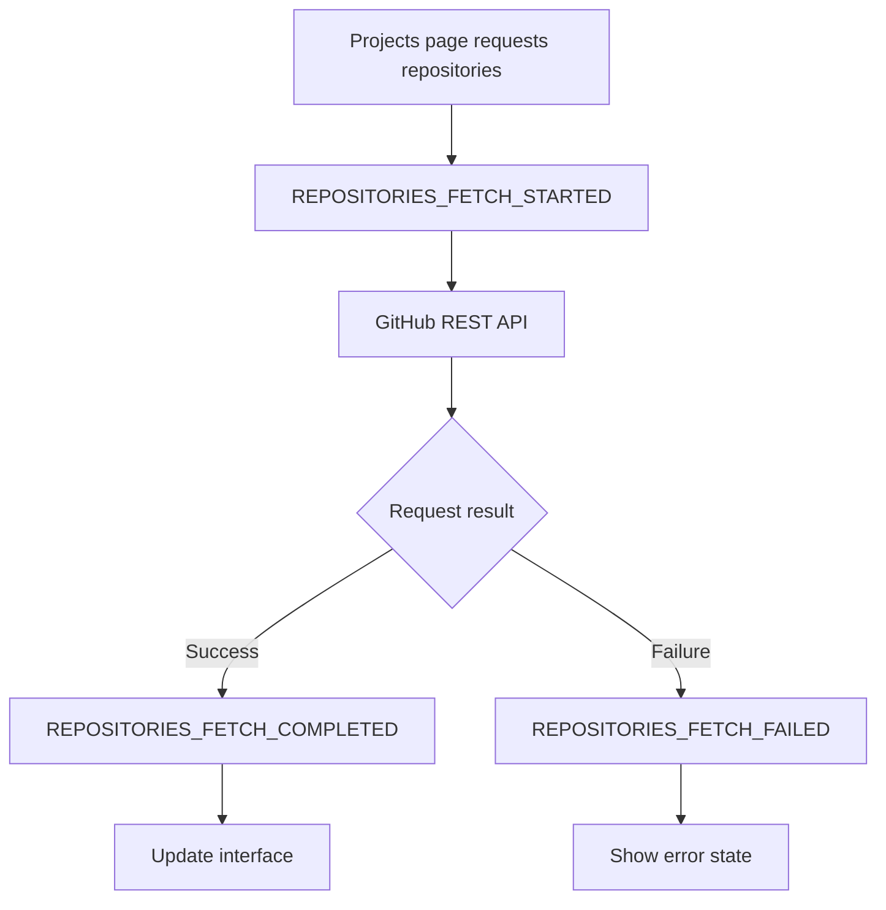

# Student Portfolio & Task Management System

<p align="center">
<strong>A full-stack portfolio that grows through 13
practicals</strong><br> React · Vite · Node.js ·
Express · MongoDB · JWT · NodeCache · Docker · GitHub Actions · Groq AI
</p>
<p align="center">
<a href="https://github.com/MeetKumar6789/student-portfolio/actions/workflows/ci.yml">

</a>


</p>
A personal portfolio and task-management application built as a
progressive full-stack project. Across 13 practicals, it brings together
frontend development, REST APIs, database operations, authentication,
caching, asynchronous workflows, event-driven design, Docker, CI
automation, and AI-assisted task descriptions.

> **Project principle:** AI suggestions are optional. Users can review
> and edit generated text, and normal manual task creation remains
> available if the AI provider is unavailable.

------------------------------------------------------------------------

## Quick navigation

-   [✨ Highlights](#-highlights)
-   [🏗️ Architecture](#️-architecture)
-   [🧰 Technology stack](#-technology-stack)
-   [🚀 Run locally](#-run-locally)
-   [🐳 Run with Docker](#-run-with-docker)
-   [🔌 API reference](#-api-reference)
-   [🤖 Practical 13: Groq
    AI](#-practical-13-groq-ai-task-description-generator)
-   [⚡ Caching](#-caching)
-   [🔄 Async and event-driven
    workflows](#-async-and-event-driven-workflows)
-   [🧪 Testing and verification](#-testing-and-verification)
-   [🔐 Environment and security](#-environment-and-security)
-   [🗺️ Demo checklist](#️-demo-checklist)
-   [🎓 Learning outcomes](#-learning-outcomes)

------------------------------------------------------------------------

## ✨ Highlights

<table>
<tr>
<td width="50%">
<h3>
🌐 Portfolio experience
</h3>
Responsive React interface, reusable components, navigation, project
information, contact form, and GitHub repository fetching.
</td>
<td width="50%">
<h3>
✅ Task management
</h3>
Register and sign in, authenticate requests, and create, read, update,
and delete tasks backed by MongoDB.
</td>
</tr>
<tr>
<td>
<h3>
⚡ Performance
</h3>
NodeCache with a 60-second TTL, cache invalidation after mutations, and
cache statistics for practical verification.
</td>
<td>
<h3>
🔔 Event monitoring
</h3>
A custom event bus, asynchronous contact-processing simulation,
repository-fetch events, and a live event monitor.
</td>
</tr>
<tr>
<td>
<h3>
🐳 Containerization
</h3>
Docker Compose services for the frontend, Express API, and MongoDB, with
service networking and persistent database storage.
</td>
<td>
<h3>
🧠 AI-assisted descriptions
</h3>
An authenticated backend endpoint uses Groq to suggest task descriptions
from a title. Suggestions remain editable.
</td>
</tr>
</table>
## 🧭 Practicals 1--13

The project is documented as a progression from frontend foundations to
a containerized, tested, AI-enabled application. Some earlier practicals
were grouped by phase in the original project notes; consult the
individual reports for their exact prescribed titles and marking
criteria.

<details open>
<summary>
<strong>Practicals 1--4 · Portfolio
foundation</strong>
</summary>
**Focus:** frontend structure and presentation.

-   Build the portfolio interface and reusable components.
    -   Implement styling, page sections, and navigation.
    -   Organize the application structure and frontend assets.
    -   Develop the foundation for later integrations.

    <em>The source README groups these practicals together and
    does not specify each practical's exact title.</em>

</details>
<details>
<summary>
<strong>Practical 5 · Task management and
database</strong>
</summary>
**Focus:** persistent task data and CRUD operations.

-   Define the task model and connect to MongoDB.
    -   Implement create, read, update, and delete operations.
    -   Connect task-management behavior to the application.

</details>
<details>
<summary>
<strong>Practicals 6--8 · Backend and application
integration</strong>
</summary>
**Focus:** API development and secure frontend/backend communication.

-   Progressively develop backend API functionality.
    -   Implement authentication and request validation.
    -   Integrate the frontend with backend endpoints.
    -   Use the individual practical reports for the exact titles and
        detailed requirements.

</details>
<details>
<summary>
<strong>Practical 9 · Caching and performance</strong>
</summary>
**Focus:** reducing repeated database reads with NodeCache.

-   Configure a 60-second time-to-live (TTL).
    -   Cache task-list and individual-task reads where implemented.
    -   Invalidate affected cache entries after task mutations.
    -   Inspect cache statistics and compare repeated requests.
    -   Understand the difference between in-memory cache data and
        persistent MongoDB data.

</details>
<details>
<summary>
<strong>Practical 10 · Asynchronous processing and event-driven
architecture</strong>
</summary>
**Focus:** responsive asynchronous workflows and observable events.

-   Use Promises, `async/await`, and `try/catch/finally`.

    -   Show loading, success, empty, and error states.
    -   Fetch GitHub repository information asynchronously.
    -   Use a custom event bus to decouple event producers and
        consumers.
    -   Display recent events in the Event Monitor.
    -   Test success and simulated failure flows.

    **Example events**

    `CONTACT_FORM_SUBMITTED` · `MESSAGE_PROCESSING_STARTED` ·
    `MESSAGE_PROCESSING_COMPLETED` · `MESSAGE_PROCESSING_FAILED` ·
    `REPOSITORIES_FETCH_STARTED` · `REPOSITORIES_FETCH_COMPLETED` ·
    `REPOSITORIES_FETCH_FAILED`

    > Contact processing is a simulation. It does not send real emails
    > or use a production message broker.

</details>
<details>
<summary>
<strong>Practical 11 · Docker
containerization</strong>
</summary>
**Focus:** packaging and running the application services together.

-   Build frontend and backend images.
    -   Run frontend, backend, and MongoDB using Docker Compose.
    -   Connect services through an internal Docker network.
    -   Serve the frontend through Nginx.
    -   Use MongoDB health checks and a named volume for persistent
        data.
    -   Inspect service logs and verify startup behavior.

      Service        Typical host port Role
      ------------ ------------------- ------------------
      `frontend`                `5173` Portfolio UI
      `backend`                 `5000` Express REST API
      `mongodb`                `27017` Database

    Actual port mappings are defined in `docker-compose.yml`.

</details>
<details>
<summary>
<strong>Practical 12 · CI pipeline with GitHub
Actions</strong>
</summary>
**Focus:** automatically checking changes before integration.

The workflow in `.github/workflows/ci.yml` is documented to run on
pushes to `master` and pull requests targeting `master`.

-   Install dependencies from lockfiles.

    -   Run the configured lint command.
    -   Build the frontend.
    -   Run backend tests.
    -   Inspect failed workflow steps to identify installation, test, or
        build problems.

    **CI is not deployment:** the documented workflow checks code; it
    does not automatically deploy the application.

    > **Evidence note:** the original README says the demonstration run
    > links were pending. Add real GitHub Actions run links after
    > verifying the runs in the repository's **Actions** tab.

</details>
<details>
<summary>
<strong>Practical 13 · Groq AI task-description
generator</strong>
</summary>
**Focus:** adding an AI suggestion workflow without replacing normal
task creation.

1.  Enter a task title.
2.  Click **Generate Description**.
3.  Review and edit the suggested description.
4.  Confirm before replacing an existing description when prompted.
5.  Save through the existing task-creation flow.

**Endpoint:** `POST /api/ai/generate-description`

**Request body:**

``` json
  {
    "title": "Complete the database assignment"
  }
```

**Successful response contract:**

``` json
  {
    "success": true,
    "description": "A generated task description appears here."
  }
```

-   The endpoint requires authentication.
    -   The Groq API key stays on the backend in `GROQ_API_KEY`.
    -   The implementation includes a per-authenticated-user cooldown of
        one AI request per minute.
    -   The task title is sent to an external AI provider, so users
        should not include sensitive information.
    -   Generated text may be inaccurate; review it before saving.
    -   Manual task creation should remain usable if AI generation
        fails.
    -   Automated tests should mock the provider rather than make paid
        or live API calls.

    Provider availability, supported models, rate limits, and charges
    depend on Groq's current account terms and model availability.

</details>
## 🏗️ Architecture



The frontend communicates with the Express API over HTTP. Protected
operations use the project's authentication middleware. The backend
applies validation, caching where appropriate, and MongoDB persistence.
The AI route sends the task title to Groq and returns a suggestion for
the frontend to display.

For Docker Compose, the backend uses the MongoDB service hostname on the
internal network, typically:

``` text
mongodb://mongodb:27017/taskdb
```

Use the URI and environment configuration defined by your actual
runtime. A local backend may use a local MongoDB address instead.

## 🧰 Technology stack

  Area                  Technologies
  --------------------- ---------------------------------------
  Frontend              React, JavaScript, HTML, CSS
  Frontend tooling      Vite, npm
  Backend               Node.js, Express.js
  Database              MongoDB, Mongoose
  Authentication        JWT, bcrypt
  Validation            Server-side validation and middleware
  Caching               NodeCache, 60-second TTL
  Async workflows       Promises, `async/await`, Fetch API
  Event-driven design   Custom JavaScript event bus
  External services     GitHub REST API, Groq API
  Containerization      Docker, Docker Compose
  Web server            Nginx
  CI                    GitHub Actions
  Version control       Git, GitHub

## 🚀 Run locally

### Prerequisites

-   Node.js and npm versions compatible with the project's package
    files.
-   MongoDB running locally or an accessible MongoDB instance.
-   Git.
-   A Groq API key only if you want to test AI generation.

### 1. Clone the repository

``` bash
git clone https://github.com/MeetKumar6789/student-portfolio.git
cd student-portfolio
```

### 2. Install frontend dependencies

``` bash
npm install
```

### 3. Configure the backend environment

Create or update `task-manager-api/.env` using the existing
`.env.example` as a reference. Keep your real credentials only in the
ignored local `.env` file.

Example variable names:

``` env
MONGO_URI=mongodb://127.0.0.1:27017/taskdb
JWT_SECRET=replace-with-a-strong-local-secret
GROQ_API_KEY=your_groq_api_key
```

> Environment variable names and the MongoDB URI must match the current
> backend configuration. Keep existing variables already required by
> your project. Never paste real secrets into this README.

### 4. Install backend dependencies

Open a second terminal:

``` bash
cd task-manager-api
npm install
```

### 5. Start the backend

From `task-manager-api/`:

``` bash
npm start
```

If the package does not define a `start` script, use the command
specified in its `package.json` (the existing project documentation also
describes `node server.js`).

The API is expected to listen on port `5000` when configured
accordingly.

### 6. Start the frontend

In another terminal, from the repository root:

``` bash
npm run dev
```

Open <http://localhost:5173>.

### 7. Build the frontend

From the repository root:

``` bash
npm run build
```

Vite writes the production build to `dist/`.

## 🐳 Run with Docker

Run these commands from the directory containing `docker-compose.yml`.

### Build and start

``` bash
docker compose build
docker compose up -d
docker compose ps
```

### Inspect logs

``` bash
docker compose logs --tail=100
docker compose logs --tail=50 backend
docker compose logs --tail=50 frontend
docker compose logs --tail=50 mongodb
```

### Validate Compose configuration

``` bash
docker compose config --quiet
```

### Stop services

``` bash
docker compose down
```

This normally preserves the named MongoDB volume. Avoid
`docker compose down -v` if you need to keep your database data.

### Groq key in Docker

If AI generation is enabled in Compose, configure `GROQ_API_KEY` through
the local environment or an ignored environment file as supported by the
Compose configuration. Do not hardcode it in `docker-compose.yml`,
frontend variables, image build arguments, or source code. After
changing environment configuration, recreate the backend container so it
receives the updated variable.

## 🔌 API reference

Base URL for local development:

``` text
http://localhost:5000
```

  --------------------------------------------------------------------------------
  Method                  Endpoint                         Purpose
  ----------------------- -------------------------------- -----------------------
  `POST`                  `/register`                      Register a user

  `POST`                  `/login`                         Authenticate a user

  `GET`                   `/me`                            Get the authenticated
                                                           user's information

  `GET`                   `/tasks`                         Retrieve tasks

  `POST`                  `/tasks`                         Create a task

  `GET`                   `/tasks/:id`                     Retrieve a specific
                                                           task

  `PUT`                   `/tasks/:id`                     Update a task

  `DELETE`                `/tasks/:id`                     Delete a task

  `GET`                   `/tasks/cache/stats`             Retrieve cache
                                                           statistics, if enabled

  `DELETE`                `/tasks/cache/clear`             Clear the task cache,
                                                           if enabled

  `POST`                  `/api/ai/generate-description`   Generate an AI task
                                                           description
  --------------------------------------------------------------------------------

Protected routes require the bearer-token format expected by the
backend. Check the route and middleware definitions for the exact
authentication requirements and request schemas. The `/` route may
return `404` if no root endpoint is defined; test the documented
endpoints instead.

### Example: call the AI endpoint

First sign in using the existing login endpoint and obtain the token
returned by your application. Then make an authenticated request:

``` bash
curl -X POST http://localhost:5000/api/ai/generate-description \
  -H "Content-Type: application/json" \
  -H "Authorization: Bearer YOUR_LOGIN_TOKEN" \
  -d "{\"title\":\"Complete the database assignment\"}"
```

Replace `YOUR_LOGIN_TOKEN` with your actual local login token. Do not
commit tokens or include them in public screenshots.

## 🤖 Practical 13: Groq AI task-description generator

The AI feature is designed as an assistant, not an automatic task saver.



### Behavior and safeguards

-   **Authentication:** requests use the existing authenticated API
    flow.
-   **Validation:** the backend validates the title before calling the
    provider.
-   **Cooldown:** one AI request per authenticated user per minute, as
    implemented.
-   **Secret handling:** the key is backend-only and must never be
    exposed to React.
-   **User control:** the user can review and edit the suggestion.
-   **Graceful degradation:** AI failure should not prevent manual task
    creation.
-   **Privacy:** task titles are sent to Groq; avoid sensitive content.
-   **Testing:** use mocks for automated tests so the suite does not
    require a live provider request.

### Troubleshooting

<details>
<summary>
<strong>AI request returns 401 or 403</strong>
</summary>
Check that `GROQ_API_KEY` is present in the backend environment, valid,
and permitted for the selected model. Verify the model name against
Groq's current model documentation and check account/project
restrictions. Restart the backend after changing `.env`. Never print the
key in logs.
</details>
<details>
<summary>
<strong>AI request returns 429</strong>
</summary>
The app's per-user cooldown may be active, or the provider may be
enforcing its own rate limit. Wait for the app cooldown to expire and
inspect sanitized backend diagnostics before retrying.
</details>
<details>
<summary>
<strong>AI request returns 502 or an empty
description</strong>
</summary>
Inspect the backend's sanitized error category and verify that the
installed Groq SDK response is parsed correctly, including
`choices[0].message.content`. Handle missing or whitespace-only content
safely. Do not log the task title, API key, authorization header, or raw
provider response.
</details>
Official links: [Groq API keys](https://console.groq.com/keys) · [Groq
documentation](https://console.groq.com/docs) · [Groq
models](https://console.groq.com/docs/models)

## ⚡ Caching

NodeCache is used to reduce repeated reads for supported task endpoints.



**Verification ideas**

1.  Request the same task data more than once.
2.  Inspect the cache statistics endpoint if enabled.
3.  Compare the first request with repeated requests.
4.  Create, update, or delete a task.
5.  Verify that affected cache entries are invalidated.
6.  Remember that NodeCache is in-memory and resets when the process
    restarts.

## 🔄 Async and event-driven workflows

The frontend uses a custom event bus to separate event publishers from
event listeners.

### Contact workflow



### GitHub repository workflow



The Event Monitor shows recent application events. Loading and error
states help users understand asynchronous operations. Contact processing
is simulated and does not represent a production email service or
message broker.

## 🧪 Testing and verification

### Backend tests

Run from `task-manager-api/`:

``` bash
npm test
```

### Frontend checks

Run from the repository root, using scripts available in `package.json`:

``` bash
npm run lint
npm run build
```

If a script is not defined, inspect `package.json` and use the project's
actual configured script.

### Docker configuration

``` bash
docker compose config --quiet
docker compose ps
```

### Git whitespace check

``` bash
git diff --check
```

### CI workflow

Open the repository's [Actions
tab](https://github.com/MeetKumar6789/student-portfolio/actions) and
select **CI Pipeline**. Inspect the actual run and job logs before
reporting a pass. The README's CI badge indicates the workflow status
for `master`; it does not replace checking the latest run.

## 🔐 Environment and security

-   Never commit `.env` files containing secrets.
-   Keep `GROQ_API_KEY`, `JWT_SECRET`, database credentials, and access
    tokens private.
-   Keep `.env.example` limited to variable names and safe placeholders.
-   Never put provider keys in frontend code or frontend environment
    variables exposed to the browser.
-   Do not log API keys, bearer tokens, task titles, or raw provider
    response bodies.
-   Validate and authenticate requests on the backend.
-   Keep dependencies and lockfiles in sync when adding or removing
    packages.
-   Use a strong, unique JWT secret outside local demonstrations.
-   Review staged files before every commit.

Before committing, run:

``` bash
git status --short
git check-ignore task-manager-api/.env
git diff --check
```

## 🗺️ Demo checklist

Use this checklist when preparing a live demonstration or viva. Tick
items off as you verify them.

-   [ ] Portfolio opens and navigation works.
-   [ ] Project information and GitHub repository fetching behave
    correctly.
-   [ ] Contact form validation and asynchronous feedback work.
-   [ ] Event Monitor displays recent events.
-   [ ] Backend starts and connects to MongoDB.
-   [ ] Registration and login work.
-   [ ] Protected routes reject unauthenticated requests.
-   [ ] Task creation, retrieval, updating, and deletion work.
-   [ ] Cache behavior and invalidation can be demonstrated.
-   [ ] Frontend and backend run correctly in Docker Compose.
-   [ ] MongoDB data persists after stopping and restarting containers.
-   [ ] CI workflow has been run and its actual result checked.
-   [ ] Groq generates a task description when valid configuration is
    available.
-   [ ] Generated text can be edited before saving.
-   [ ] Manual task creation still works when AI generation is
    unavailable.
-   [ ] No secret files or credentials are included in the Git commit.

## 🎓 Learning outcomes

Through the project, the student practises:

-   Component-based frontend development with React.
-   REST API design and frontend/backend integration.
-   MongoDB persistence and CRUD operations.
-   JWT authentication, password hashing, and input validation.
-   Async JavaScript, Promises, and `async/await`.
-   Event-driven design and observable UI workflows.
-   In-memory caching and cache invalidation.
-   Docker images, Compose networking, health checks, and persistent
    volumes.
-   Automated linting, builds, and tests through GitHub Actions.
-   Secure integration of an external AI provider.
-   Safe environment-variable management and Git-based collaboration.

## Conclusion

The Student Portfolio & Task Management System connects portfolio
development with practical backend engineering. Across Practicals 1--13,
it evolves from a React portfolio into an application demonstrating
persistent task management, authentication, caching, asynchronous
events, containerization, CI checks, and AI-assisted task descriptions.

The AI feature remains intentionally user-controlled: it suggests text,
the user reviews it, and the existing task workflow performs the save.
